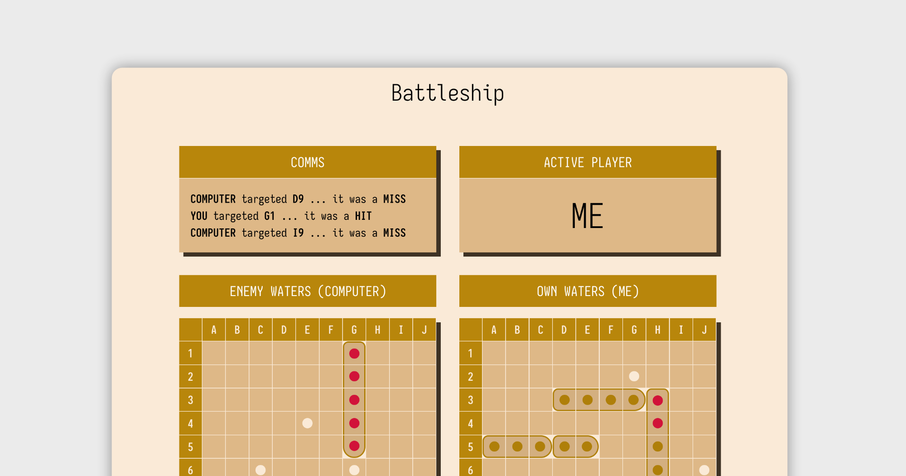

# Odin Project Battleship README



# The Odin Project - A Battleship Game

This is a solution to the [Battleship project](https://www.theodinproject.com/lessons/node-path-javascript-battleship#project-solution) from The Odin Project. It is the capstone project of the JavaScript course, and the last project to be done in Vanilla JS/HTML/CSS.

## Links

- Source code on [GitHub](https://github.com/sydalwedaie/odin-project-battleship)
- Live preview on [Netlify](https://ugcy2-odin-project-battleship.netlify.app/)

## How to run a local instance

Clone the repo and run the following:

```sh
$ npm install
$ npm run serve
```

Point your web browser to `http://localhost:8080/`. Make sure the port matches what Webpack prints after running the above code)

## Project Structure

At this point of the curriculum, The Odin Project has not yet introduced the concept of MVC architecture. However, over the course of building many projects from scratch, I somewhat came up with my own version.

All the app-related logic lives in the `/src/script` directory. Below are the critical files I’ll be referencing througout this README.

```
The /src/scripts directory

├── controller
│   ├── console.js
│   └── controller.js
├── game
│   ├── game.js
│   ├── gameboard.js
│   ├── player.js
│   └── ship.js
├── helpers
│   ├── dom.js
│   ├── grid.js
│   ├── iterators.js
│   ├── random.js
│   ├── ship.js
│   └── validators.js
└── view
    ├── attr.js
    ├── comms.js
    ├── console.js
    ├── gameboard.js
    ├── gameover.js
    ├── grid.js
    ├── init_game.js
    ├── place_ships.js
    └── view.js
```

## The game model

> **Caution**: The code snippents throughout this README may not fully reflect the final implementation in the source code. They’re often intentionaly modified to better demonstration of the concept.

The main logic of the game (aka the Model), lives in the `src/scripts/game` directory. It includes factory functions for each part of the game. Each module exposes methods that can be used to control the game state. They have no knowledge of, and can not control, the **display** of game state in any shape or form.

### The `Ship` module

**Job**: It takes a length and a name and produces an object that defines what a ship is and what it can do.

A ship does not know where in the board it is located, nor which part of it was hit. But it can:

- tell you how many times it was hit through the `getHitCount()` method,
- increment the hit count through the `hit()` method,
- and tell you if it’s sunk through the `isSunk` method

It also exposes `name` and `length` as properties of a ship.

This factory had a `hitCount` static property and a function to increment it. I returned the static property as it, but that was a mistake. Although calling the increment function worked as intended, retrieving the static `hitCount` property wouldn’t show the update.

The reason is, the returned `hitCount` propety holds the initial value at time of initialization, which is zero. It does not point to the actual `hitCount` property inside the factory. So I must create some sort of a **getter** function to dynamically retrive the updated value. And that’s why there is a `getHitCount` method on the `Ship` factory.

### The `Gameboard` module

**Job:** It creates an object that holds the status of a single board.

A physical game of Battleship has 4 boards: 2 for each player, a lower and upper board. The lower board (let’s call it the **player’s own board**) shows the player’s ships and marks the enemy’s shots with red pegs for hits, and white pegs for misses. The upper board (let’s call it the **target board**) shows the player’s attempts at shooting the enemy, again marking hits with red pegs and misses with white.

If you think about it, a **target** board has the same information as the **player’s own board**. If a cell is shot, it will be marked with with a peg on both. The only different is how they’re displayed. A target board never displays ships, until their fully sunk. So we really need 2 boards in the game state: a Player 1’s and a Player 2’s.

But a`gameboard` object created in this module has no knowledge of which player it belogns to, or whether its a target board or a player’s own board. We will be using it in other modules to instantiae separate boards.

A board consists of 100 cells, arranged in a 2D array of arrays. The level-one arrays are the rows, of which there are 10. Each row array contains 10 cells. Each cell contains a reference to a ship and whether that cell is shut or not.

A cell has the following format:

```js
{ ship: null, isShut: false }
```

The concept of **placing a ship** occurs in this module. Cells that have a reference to a specific ship object are considered occupied. The board would know that, for instance, a _carrier_ is placed on the board if 5 concecuitive cells have thier `ship` property set to reference a carrier ship object.

For this, a `placeShip()` mthod takes a `ship` object and a position. A position is an array of 3 elements: `[row, col, orientation]`. It then verifies if the position is valid, loops through consecuitive cells for as long as the ship length, and sets their `ship` property to the `ship` object that was passed in. It also adds the ship to a `fleet` array, which is going to track the status of the fleet for later modules.

There needs to be 3 layers of validation before placing a ship. The position passed to `placeShips` defins the position of the **tail** of the ship. The first validation checks if this position falls inside the board. The second validation checks of the remainder of the ship is still inside the board. And the third validation checks of the current placement does not overlap any other ship.

The concept of **registering an attack** also lives here. Again, a gameboard object has no knowledge of who’s attacking who. It just knows how to **recieve** an attack. For this, a `receiveAttack()` method takes a target (in the form of an array of row and column indicies), checks if the target is valid, and updates the cell. The update has two parts: it sets the `isShut` property to `true`, so as to indicate the cell has been shot. The second part determines if the cell has a ship, and if so, increments it’s `hit` count. Note that a cell does not have a way to show whether a shot was a hit or a miss. Instead, we can dynamically deduce this information based on a combination of ship presence and the `isShut` property. For example, if a ship is present and the `isShut` property is `true`, the shot status would be a hit.

Finally, a `gameboard` object can determin if all of its ship have been sunk. A `allShipsAreSunk()` method loops over the `fleet` array and runs the `isSunk()` method from the `Ship` module on each ship.

### The `Player` module

**Job**: Takes a `name`, instantiates a `gameboard` object, and places 5 ships on the board.

The `gameboard` object had a method to place only one ship. The `Player` module has a `placeShips()` method takes an array of 5 positions (called the `formation`) and calls the `placeShip()` method of the `gameboard` on each position, passing along one of the five available ships.

At this point, an attack on a player on coordinates `[1, 2]` can be registered like this:

```js
const player = Player("cool player");
player.gameboard.receiveAttack([1, 2]);
```

### The `Game` module

**Job**: Takes 2 player names, instantiates 2 player objects, and keeps track of the game state

In a battleship game, players take turn in attacking each other. During each turn, 1 player acts as the shooter, while the other one acts as the enemy who recieves the attack. The `Game` module has a `state` property that keeps track of who is the **current player** and who is the **current enemy**, as well as the game over status.

```js
const state = {
  currPlayer: player1,
  currEnemy: player2,
  gameover: false,
};
```

The whole game state and methods can be accessed through this object.

A `playTurn()` method takes a target coordinate, and calls the `recieveAttack()` method on the **current enemy**, which on the first turn is hard-coded to be `player 1`. It then **swaps** the current enemy with the current player, so the next time `playTurn()` is called, it will be on the other player. However, a player swap won’t trigger if a game over condition is detected.

As you can see, the `playTurn()` method has no internal knowledge of who is attacking who. It just calls `recieveAttack()` on the player that’s currently designated as the enemy (which is stored in the game state) during each turn. The players keep alternating in being the current enemy each time `playTurn()` is called. In other words:

```js
const game = Game("Player 1", "Player 2");
// Round 1
game.playTurn([0, 0]); // Player 1 registers an attack on player 2
game.playTurn([0, 0]); // Player 2 registers an attack on player 1

// Round 2
game.playTurn([1, 1]); // Player 1 registers an attack on player 2
game.playTurn([1, 1]); // Player 2 registers an attack on player 1
```

This arrangement allow us to simulate a **computer player**. First, it’s important to note that a computer player object and a regular player object are completely identical. The way the game simulates a computer player is in the way it aquires the target coordinates. For a regular player, this coordinate comes from the user; either through the console by calling the method with with specific coordinates (like what we did above) or by clicking on a cell in the web interface. Meanwhile, a computer player gets its coordinates from a random target generator. For this, a`generateValidTargetRandom()` method keeps selecting random coordinates until it finds one that has not been already shot. A computer player would pass the output of this method as the argument to the `playTurn()` method. Therefore, a single player arrangement will look something like this:

```js
const game = Game("Player", "Computer");
// Round 1
game.playTurn([0, 0]); // Player registers an attack on Computer
game.playTurn(generateValidTargetRandom()); // Computer registers an attack on Player

// Round 2
game.playTurn([0, 0]); // Player registers an attack on Computer
game.playTurn(generateValidTargetRandom()); // Computer registers an attack on Player
```

The task of coordinating when to call by a user coordinate and when to call by a random target is done by the controller (discussed later).

## The console view/controller

At this point, the game is fully playable from the console, though there is no visual whatsover! This is my preferred method of disigning games: to build a fully functional game logic first and to make it work in the console. Once I get the whole thing wired up and have a clear mental model, I start working on the web view/controller. If coded correctly, the `Game` module does not care which version is used to call its method.

There is `ViewConsole` module in the `/scripts/view` directory, and a `ControllerConsole` module in the `/scripts/controller` directory. These two have to knwolege of the internal mechanism of each other, nor of the `Game` module.

The `ViewConsole` module takes the game state as input and defines a couple of methods to print the current state of the game. Remember from earlier that a player’s gameboard can be both a target board as well as own board? We can define seperate methods to display the same board as each of the two depending on who is the playe/enemy. When printed as a target board, it will omit displaying ships, and only shows hits and misses. When printed as own board, it will also include the ship. And that’s exactly what the `printBoard()` and `printBoardAsTarget()` methods do. There is also a `printRound` method that calls these two methods to display one complete round.

Everything comes together in the `ControllerConsole` module. There, a `game` and a `view` are instantiated, providing the controller with all their methods and properties. We place random ships for each player, print a starting round, and define a `playRound()` method that allows the player to play against the computer from the console. In it, `game.playTurn()` is called twice: once with a user-provided target, and once with a random target, simulating an attack by the computer.

Note the absence of any display-related code in the controller; aka no `console.log`s. That job is purely for the View module. The controller only **wires** the model with the view acting as a bridge to pass along the game state from the game (the model) to the view. The controller is the module that calls each of the game/view methods in a specific order to run the show.

## The web view/controller

All web view related logic live in the `/src/scripts/view` directory. There are two types of view modules: **components** and **pages**. A component is something that can be rendered on multiple pages. Similar to how the game modules were all agregated in one `Game` module, there’s a `View` module in `view.js` that instantiates all the components and exposes them through a unified API.

The view components and page modules have similar internals. Depeding on purpose, a view module can have one or more of the following methods and functionalities:

- An internal logic that defines the HTML template: View modules create their own, fully independant DOM elements. They’re not HTML strings, but actual DOM elements that are created in memory and wait to be rendered to the webpage.
- A `render()` method that takes a `root` element and appends the template to the webpage.
- A `loadData()` method that dynamically updates the rendered DOM with fresh data every time it is called.
- A `bindClick*` method that takes a callback function, attaches an event listener to that specific component, and runs the callback function on the target that was clicked.

I came up with this arrangement and refined it over the course of many projects. It allows me to house all the view logic of a specific component in one single module. From the controller, I’d be able to do something like `view.gameboard.render(root)` to display an empty gameboard on the page. I then call `view.gameboard.loadData(game.state)` whenever something happens to the state to update the boards. For example, when randomizing ship placements, the board is rendered once, but the data is updated with fresh ship arrangement everytime the Randomize button is clicked.

`bindClick*` methods are a bit difficult to wrap one’s head around. In the past, I would have attached an Event Listener on the root element in the `index.js` file, and would have done all I wanted to do with target in the body of the listener’s callback. That meant I had tens of listeners in one place. A `bindClick*` does two things: let’s me define the shape of the listener inside the module and exposes the event target to the callback function. It does not actually attach the listener, yet. From the controller, I would then call this method which will actually attach the listener, and pass in a function that would get its argument from the event target that `bindClick*` exposed.

The `Gameover` view module is probably the simplest one to use an example. There’s a `generateDOM` function at the end of the module that defines the template. Again, it returns an actual DOM element, not an HTML string. This is important, as the `render()` method uses the `appendChild` method to render it to the webpage, which expects DOM elements, and not strings. The `loadData()` method expects a `msg` string, and appends to the approprate part of the template when called. The `msg` string will come from the controller, and includes data from the game’s state. Finally, the `bindClickPlayAgain()` method finds the **Play Again** button, and runs the `handleClick` callback function. From the controller, we do something like `view.gameover.bindClickPlayAgain(game.restart)`. We don’t actually call `game.restart` (aka no brackets), but let the `bindClickPlayAgain` method to the calling only when the button is clicked. In this example, there was no need to transfer any user input from the view to the controller, because `game.restart` did not need an input. But in a `Grid` view module, for example, a `bindClickShoot` method would pass along the cooridinates that were clicked to the callback function, wich will be something like a `game.playTurn` that expects target coordinates as its input.

## Design decisions

### Use of factory functions vs. classes

TOP never favored using either of these in any project. I would alternate between them, but lately I began to prefer factory functions. Their syntax is much easier to understand, and they don’t need a million `this`.

In my opinion, there is only one disadvantage: I have to remember to acturally return the methods and properties I need exposed. The other, potentional disadvatage relates to performance. Methods in a class are defined on the prototype, and thus are shared among every instance of the class. This is important when the number of instances are many. In this application, each factory function is instantiated only once. I may have considered using a class for creating the object in each cell, since there are a 100 cells in each grid. I decided against that because these cells do not have methods, so the method-sharing benefits of the prototype won’t even apply.

### Chaning methods vs. native APIs

In the game-related modules, the `Ship` module exposes a couple of methods and properties, like `hit` and `isShut`. The `Gameboard` module uses `Ship` and exposes methods like `placeShip` and `receiveAttack`. The `Player` module uses both previous modules and exposes a `placeShips` method. The `Game` module initializes players using the `Player` module and exposes a `playTurn` method. And finally, a `Controller` module that runs the show.

In the controller, I have a line like this:

```js
game.player1.placeShipsRandom();
```

The `Game` module does not expose a native `placeShipsRandom` method. It exposes the whole `player` object, which does expose that method, which itself uses the `placeShips` internally. I briefly considered the option of encapsulating that natively in the `Game` module, so I could have something like this:

```js
game.placeShipsRandom(player1);
```

I have decided to mostly NOT do that, and let each module access methods through chaining. So if I wanted to access a ship, I would do something like this:

```js
game.player1.gameboard.grid[row][col].ship;
```

I had two main reasons for doing it this way:

1. As my mental model was growing alongside the code, forcing myself to access methods and properties through drilling down the modules helped me keep the mental model in my working memory. Without this, I would have eventually forgot where each method and property came from.
2. It helped me avoid premature optimization. Again, because I still didn’t have the complete mental model, it felt prefereable to not hide the functionality behind layers of abstraction until I got the full picture.

Of course, there are pros and cons to each approach, and I’ll be experimenting with both in future projects.

### View moduels with zero knowledge of the state

At one point, I had something like this somewhere inside one of my _view_ modules:

```js
// view.js
const loadData = (state) => {
  namePlayerEl.textContent = state.player.name;
  nameEnemyEl.textContent = state.enemy.name;
};
```

The module has internal logic to first render the DOM with no data, and exposes a `loadData` method that injects live information from the game’s `state`. Then I would simply call it from the _ controller _ to update the interface:

```js
// controller.js
view.loadData(state);
```

It worked, and I thought it was pretty elegant, since it would be the same for any other _view_ module that has a `loadData` method. Just call them with `state`.

But then I began to wonder: why should the _view_ know about the internal structure of the `state`? It lives in a separate _game logic_ module and has nothing to do with the view.

So I changed it to this:

```js
// view.js
const loadData = (namePlayer, nameEnemy) => {
  namePlayerEl.textContent = namePlayer;
  nameEnemyEl.textContent = nameEnemy;
};
```

Now the view has no knowledge of the state. It just expects individual arguments, and the controller would decide how to present those arguments:

```js
// controller.js
view.loadData(state.player.name, state.enemy.name);
```

This approach makes it a bit harder to call the method, since each view’s `loadData` method would expect a different set of arguments. I would have to either open the view’s file to remember what arguments were expected, or hope the IDE provides the correct function signature on hover.

It’s also especially cumbersome if I needed to call it more than once; for example, to update the interface after the user plays a turn. In my actual code, `loadData` expects many arguments, and I needed to call it twice. So again, I tweaked the logic so it would expect the arguments in the form of an object:

```js
// view.js
const loadData = ({ namePlayer, nameEnemy }) => {
  namePlayerEl.textContent = namePlayer;
  nameEnemyEl.textContent = nameEnemy;
};
```

```js
// controller.js
const stateBoard = {
  namePlayer: state.player.name,
  nameEnemy: state.enemy.name,
};

view.loadData(stateBoard);
```

But that created a problem with **stale state**. The properties of `namePlayer` and `nameEnemy` were assigned the values of the `state` at the time of assingment. So in the next turn when the player and enemy are swapped, these properties would still hold the old values. So again, I had to modify it:

```js
// controller.js
const getStateBoard() {
  return {
	namePlayer: state.player.name,
    nameEnemy: state.enemy.name,
  }
}

view.loadData(getStateBoard)
```

This way, a fresh state is generated everytime it’s called.

Overall, I’m writing more code, but I feel it's neater. The views and game logic have no knowledge of each other, and the interaction only occurs in the controller. If I change the state’s internal structure for whatever reason, the _views_ don’t need to change. I just change how I present the expected arguments in the controller.

### View modules generating real DOM

In `view` modules, I used to make a variable holding markup, then in a `render` function generate the DOM out of the markup and append it to a root passed as argument. I had problem trying to render components views inside page views, in which I could not do DOM manipulation before the render function. In `gameboard` view module, for instance, I needed to do this to instantiate the two `grid` views, which needed a root node inside the game board. However, inside the `Gameboard` the DOM did not exist yet (the Gameboard had not yet been instantiated) so I could not do DOM selection. For this reason, I changed the logic to generate the DOM straight away which allowed me to do DOM manipulation as if it already existed.

### Error handling

I made extensive use of custom errors throughout the game logic. For each module, I checked for invalid inputs or conditions that would prevent the code from moving forward. For example, the `Ship` module won’t accept a ship length that less than 2 or greater than 5. Another one in `Gameboard` to prevent invalid position inputs As I was progressing, I realized at some point I needed to "handle" those errors, but when? At what stage of the code flow should an error be handled instead of haulting the program? In othe words, where should I make use of `try...catch` statements? For instance, the `playTurn` method in `Game` would throw an error if an attemp to play was made after a game over. Who should see this error? Is it right there, in the controller, or the human player?

I realized error-throwing code was very helpful during developement. As I progressed deeper into the codebase, errors from smaller modules would stop me from building a logic on shaky ground. So I kept those errors unhandled all the way to the controller. Each module had it’s own logic to prevent triggering the error of the modules it depended on, and I could make them because I could litterally see the error being thrown without them. For example, there was no way for a `Player` module to place ships incorrectly, because the `placeShip` method of the underlying `Gameboard` would prevent that.

The only error condition that made it’s way all the way to the human player was trying to shoot a cell that was already shut. It was then when I made use of `try…catch` statement to display the error on the DOM. But even then, I realized I could literally disable those cells and prevent the player from targeting them in the first place! Therefore, the haman user would never see any of the error conditions.

TL;DR: Error messages must propagate all the way up to catch problems during development, but never shown to the human user. They help build the API as it gets more sophisticated.

## How I did X

### Create the grid

I wanted to dynamically create a 2D array without using a nested `for` loop. I learned I could do `Array(length).fill()` to create a 10-element array I could iterate over with `map`. So I could do somthing like this to create an 10-element array, each representing an empty row of the array:

```js
const grid = Array(10).fill();
```

I then mapped over each row with another 10-element array created with the same technique to fill each each row with a 10-element array, each representing an empty cell:

```js
const grid = Array(10)
  .fill()
  .map(() => Array(10).fill());
```

So now I had a 2D array of arrays with empty cells. Once again I mapped over each cell to fill it with the content of a gameboard cell

```js
const grid = Array(10)
  .fill()
  .map(() =>
    Array(10)
      .fill()
      .map(() => ({ ship: null, isShut: false })),
  );
```

It worked, but it could be better. I could abstract the first map’s callback into a dedicated function to act as the row generater, and and the second map’s callback to be a cell generator. And that’s how I arrived at the current implementation:

```js
const cell = { ship: null, isShut: false };
const row = () =>
  Array(10)
    .fill()
    .map(() => cell);
const grid = Array(10).fill().map(row);
```

It didn’t work! There was one grave error: I didn’t define `cell` was a constant that held an actual object. This made ALL the cell objects in the entire grid to reference the exact same object in memory, so changing the content of one cell made all other cells show the same value! It took me way too long to figure out I should have made `cell` a mini factory function! And so here was the final iteration:

```js
const cell = () => ({ ship: null, isShut: false });
const row = () => Array(10).fill().map(cell);
const grid = Array(10).fill().map(row);
```

### Share functionality between factory functions

As stated earlier, the way I modeled the gameboard had no internal knowledge of whether it was going to be a target board or a player’s own board. The difference would only show itself in the display. And so I created two view module: `GridEnemy` and `GridPlayer`. But both had a lot of shared functionality and so it was the perfect opportunity for composition, which is akin to the concept of inheritance in Classes.

I created a parent `Grid` factory function, and exposed the shared method, which the `render` and `loadData`. However, `loadData` needed to display the same data differently. So in each of the child factory functions I did the following:

- Instantiate an instance of the parent factory
- Re-define the `loadData` method accordinglty
- Return it in a combined statement together with what I needed from the parent factory

```js
return { render: grid.render, loadData };
```

For refrence, I could have also used the following technique to combine the returned methods. This would be useful if the parent factory had many more methods.

```js
return Object.assign({}, parent, { child methods })
```

### Iterate over 2 arrays

In the `Player` module, I needed to use `forEach` and iterate over 2 arrays at the same time: one that held the 5 ships definitions (their lengths and names), and another one holding an array of 5 positions. The way to achieve that is to make use of the optional `index` parameter of `forEach`:

```js
const numbers = [1, 2, 3, 4];
const letters = ["a", "b", "c", "d"];

numbers.forEach((num, index) => {
  const letter = letters[index];
  console.log(num, letter);
});
```

### Disabe the inactive grid

I had to find a way to temporarily disable the player’s grid while the enemy (the computer) was playing, otherwise duplicate events would fire. I adapted ~[this article's idea](https://www.xjavascript.com/blog/disable-all-click-events-on-page-javascript/)~ and added a **blocker event** that would prevent all other events. It would take the form of a **toggling mechanism** that would add/remove a block event function based on an indicator class.

The block event function looks like this:

```js
const blockEvent = (e) => {
  e.preventDefault();
  e.stopPropagation();
};
```

I set up a toggling mechanism as follows inside the `GridEnemy` factory function (simplified code):

```js
const toggleDisableGrid = () => {
  if (gridEl.classList.contains("disabled")) {
    gridEl.removeEventListener("click", blockEvent, true);
  } else {
    gridEl.addEventListener("click", blockEvent, true);
  }
  gridEl.classList.toggle("disabled");
};
```

I would then call this method from the controller to disable the enemy grid right after the human player plays a turn, and call it again after the computer plays its turn to reactive the grid.

Note in particular the use the third, optional `useCapture` argument in the Event Listener. From my current understanding, events occur in three phases: Capture phase, target phase and bubbling phase. Since the goal is to block ALL events, we set `useCapture` to `true` to block all events right from the beginning.

Also, I had to put the `blockEvent` function outside the `toggle` function or it wouldn’t work.

### Disable shut cells

After targeting a cell, I wanted to disable that cell from being clicked again. Sure the game model would prevent playing an already shut cell, but I wanted to also style shut cells differently. Namely, remove the hover effect and display a custom cursor.

For this, I added the `disabled` attribute after a cell is shut.

```js
cellEl.setAttribute("disabled", "");
```

`.removeAttribute("disabled")`,

Then, I used the `:disabled` and `:enabled` pseudo-classes to style each cell type accordingly.

```css
.grid-cell {
  cursor:
    url("target.png") 16 16,
    pointer;
  &:disabled {
    cursor:
      url("target-not-allwed.png") 16 16,
      not-allowed;
  }
}
```

One thing I learned here was that there is a difference between the **attribute selector** `[disabled]`, and the **pseudo-class** `:disabled`. In the CSS code above I used the pseudo-class. The top answer in [this stackoverflow post](https://stackoverflow.com/questions/20141450/should-i-use-css-disabled-pseudo-class-or-disabled-attribute-selector-or-is-i) says to prefer pseudo-classes:

> […] choose `:enabled` and `:disabled` over `:not([disabled])` and `[disabled]` simply because the pseudo-classes carry semantics that the attribute selector does not.

### Display ships

For the majority of the game’s visual development, I displayed ships with the first letter of their names, hits with `X`s and misses with `O`s. Like this:

Towards the end, I needed to figure out a way to display a ship as one continues set of cells, enclosed in a border. The challenge was to figure out which part of the ship a cell represented, as that would affect the display of borders. For example, heads and tails of a ship would have 3 sides enclosed, while a mid-section would only have too: left and right. To make things even more complicated, ships can be horizontal or vertical, so a `border-left` would mean different sides of a ship depending on its orientation.

Since a single cell of the gameboard had to internal knowledge of which part of a ship it belonged to, I came up with a somewhat elaborate set up logic to infer extra information about a cell’s position from its surrounding. The basic idea is to look at at a cell’s neighbors and see if any of them includes a ship of the same type. If any two cells shared the same ship type, that means their cells must be connected. To figure out exactly which part of the ship a cell belonged too, I would compare all 4 sides: if a cell had 3 sides with empty cells, or ships of a different type, it means that cell is either a tail or a head, and if a cell had 2 sides with the same ship type, that cell would be a mid-section.

There were in total 6 possible combinations for each cell: a tail, mid, and head section, with vertical or horizontal variation. I created a function (`addClass`, located in `/src/scripts/helpers/ship.js`) that would determine which one of these combinations a cell belonged to, and used in `view/grid.js` to add a corresponsing CSS class to that cell’s markup. For example, a horizontal ship’s tail would get `ship-horizontal-tail`. Then, in the CSS, I assigned 3 borders to this class, with a `border-right: none`.

And for the first time in a real project, I got to use the concept of **optional chaining**. to determine if there were neighboring ships of the same type, I needed to first check if there was even a cell on that side, and then if the cell had a ship, and only then retrieve it’s name (which represents the ship’s type). Attempting to retrieve a property from something that doesn’t exists (usually `undefined` in JavaScript) would through an error. This could happen for instance when trying to get the left neighbor of a cell on the left-most side of the grid. In the past I would have used `if ... else` or short-circuiting with `&&`. But optional chaining is much more elegant. It even works with bracket notation:

```js
// Is there a row above? If yes, get the cell
const cellBottom = grid[row + 1]?.[col];

// Is there a bottom cell? If yes, does it have a ship? If yes, get its name
const shipBottom = cellLeft?.ship?.name;
```

### Randomize ship placement

The random functions trigger this many times (target and placement). Big O stuff.

I created a `getRandomPos()` function in `src/helpers/random.js`. It selects random numbers from 0 to 9 for the grid coordinates, randomly picks a horizontal or vertical orientation, and returns them as a complete position array. As a reminder, the `placeShips` method of the `Gameboard` module expects a position argument in the form of `[row, col, orientation]`. I then used this function in a `getRandomPlacement()` function (in the same helper file) that would loop over the 5 ship types, and keep trying to randomly place each one until all 5 are placed. In each try, it would also check if the placement is valid (within grid bounds, not overlapping, etc).

In my experiments trying to guage the performance of this "algorithm", I found the loop triggers somewhere between 5 and 14 times, with an average of 9. There must be a smarter algorithm that would look at the grid as a graph and come up with random positions more efficiently, but at the scale of this project, even this inefficent is practically instantaneous.

### Switch views

As stated earlier, some of the view modules are of the _page_ type. I created 4 container elements in `src/template.html` to act as anchors, each representing 1 of 4 possible views of the game. I then created a `switchPage()` function in `view/view.js` that would set in `innerHTML` of all the page container elements except the selected one to an empty string. I would then render the selected page.

This approach is better than using CSS to hide the inactive pages, as it does not clutter the markup with hidden elements, which is bad for both accessiblity and performance.

## Little JavaScript tips and tricks

- When using Webpack, to access bindings in browser console, you need to attach them to the `window` object.
- An easy way to swap the values of two variables: `[varOne, varTow] = [varTwo, varOne]`. I used to to swap the active player and enemy after each turn.
- The `finally` block will ALWAYS run, even if a `return` was in the `try` block. Aka you can’t terminate the `finally` block just because you put a `return ` in `try`.
- Generate range: `[...Array(10).keys()]`. Useful for `test.each`.
- Shuffling arrays: `array.toSorted(() => 0.5 - Math.random())`. It’s a biased algorithm, but good enough for small arrays.
- `prepend` is a new(ish) DOM method to prepend elements.
- `classList.add()` must get single words per item (no spaces). So each class must be in its own quotation marks.
- Two items in a flex row container. You want to make the second one stretch the remaining width. Put `flex: 1` on the second child.
- `querySelectorAll` is the only one that produces a _static NodeList_. You can do `NodeList[index].remove()` to remove element from the DOM, but the list itself does not change (it’s not live). I used this to limit the number of messages appended to the COMMS board.
- Careful getting numbers from DOM events. They’re strings! I discovered this trying to print letter/number coordinates in the visual grid. The computer player was showing correct, but user’s showed weird chars, because the coords were strings.

## Use of advance Git concepts

This project follows a section on advanced Git. Using them elevated my workflow quit a bit.

### Git Diffs in a GUI

For years I resisted the idea of using a graphical Git app. I'm a command line purist and avoid GUI's as much as possible. But I finally gave ~[source tree](https://www.sourcetreeapp.com/)~ a try and it elevated my Git game. I still do most of my work from the command line, but use the GUI for visual diff inspection. When I do a lot of edits, I can quickly see the diffs in each file that has been edited. Then, I can decide which files to stage together for a single commit.

### Commit pieces of a file

You can stage pieces of a file, or even combine related pieces from different files! There is this concept called "hunk" in Git, where Git tries to guess groups of closely related changes in one file. This concept is available in the command like through the `-p` flag, but the GUI makes it super easy to use. Let's say you have hunks `A` and `B` in File 1, and hunks `X` and `Y` in File 2. Let's say hunks `A` and `X` are closely related, as well as hunks `B` and `Y`. You can stage each set of related hunks together and commit them separately. Mind blown :exploding_head: This was the biggest game changer in my workflow since I discovered Git branches. I can focus on my work and not worry about Git until I'm ready.

**Note**: You can also select and stage individual lines ! It can't get any better than this.

### Amend the previous commit

Often I would find a small typo or an easy bug fix right after a commit. It can happen multiple times! In the past I would have had one or more commits in the form of "fixing previous" or "fixing typo". Here’s the workflow that avoids this:

- Make the edits and save
- Run `git add .` to stage them
- Run `git commit --amend`

You’ll be presented with the opportunity to edit the last commit’s message. If all you needed was to add the new edits and keep the same message, simply close the commit editor. Your new changes will become part of the previous commit.

### Discard changes

I would often find myself wanting to dicard all changes since the last commit. If the changes are not yet staged, simply run `git checkout <target_file>`. The target file will go back to its state following the last commit. Even easier, there is a **Discard file** prompt next to the file’s name in the Sourcetree GUI app that does the same thing.

### Stashing

Sometimes I make several edits, decide I no longer want to persue that idea, but I want to somehow save the idea, in case I wanted to keep working on it later. Stashing is the solution! Running `git stash` would save a copy of the changes and remove them from the working directory (clean branch). Run `git stash apply` to restore a copy. The GUI app also has a **STASHES** view that would show all the saved stashes. It’s an awesome way to experiment with half-baked ideas without commiting them, and keep a hidden copy for future reference

## Test Driven Developement

Once again, TDD was a life saver. I had used it several times before, but not at the scale of this project. There are so many moving parts, where changing one little thing could have an avalanch effect! With TDD, I would no if a change would brake some deep code elsewhere.

For this particular project, however, I found it a little difficult to keep a string TDD workflow; aka writing the test first, doing the minimum to make it pass, and then refactoring both the code and the test. But I found it difficult to write the tests first, because I still didn’t know what the API was going to look like. I was building my mental model block by block. For example, I first coded the `Ship` factory. Then, as I was coding `Gameboard`, I realized I needed to modify `Ship` and add new properties. The model would keep changing even when I graduated to the view part of the project.

I asked the TOP community for help, and the reply was that TDD is a process of development, and a changing mental model is itself part of that process. It is indeed in the definition of TDD: refactor **both** the code and the tests.

## Reflection

Back in 2020 I knew basic programming (JS in particular). I knew what functions were, could use basic recursion, and solve beginner algorithm challenges. By that time I had re-started my learning journey a few times, so I though enough was enough and jumped to learning React. I didn't know any better. The concept of "learn the fundamentals first" was not yet a thing in my dictionary. I used a very popular paid platform for that and it was A LOT OF FUN! I did the whole course and I thought I was on top of it.

Fast forward to now, having completed the Battleship project, I understand I was under the illusion of understanding :sweat_smile: Each course was a code-along-project, with alternating lessons and mini-challenges. They were followed by "from scratch" projects that in essence were a carbon-copy of the tutorial project. I vividly remember I never spent more than a few days on each project. I was never faced with making any decision. All I needed to do was to copy the overall structure of the tutorial project. I could even do it from memory because it was still fresh. I knew how to write the code, but I didn’t know why I was using a certain pattern.

In contrast, TOP projects consistently took me 10 to 40 days to complete. As you can see from this README, I had many decisions to make, each taking me days and multiple attempt to come to a resolution. There were many dead ends, investigating possible solutions, reading docs and experiments. I did not have a blue print to follow. I had to come up everything from scratch. I now know why I used a certain pattern, and can talk about its advantages and disadvantages.
