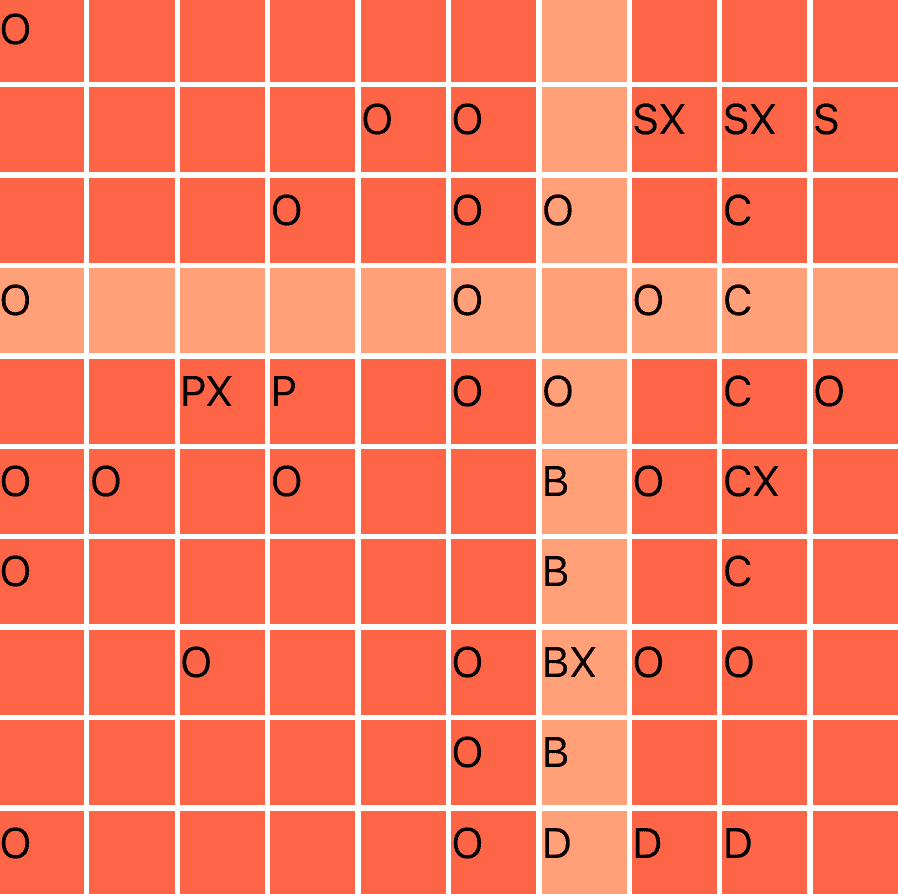

# The Odin Project - A Battleship Game

This is a solution to the [Battleship project](https://www.theodinproject.com/lessons/node-path-javascript-battleship) from The Odin Project. It is the capstone of the JavaScript course and the last major project to be done in Vanilla JS/HTML/CSS.

## Links

- Source code on [GitHub](https://github.com/sydalwedaie/odin-project-battleship)
- Live preview on [Netlify](https://ugcy2-odin-project-battleship.netlify.app/)

## How to run a local instance

Clone the repo and run the following:

```sh
$ npm install
$ npm run serve
```

Point your web browser to `http://localhost:8080/`. Make sure the port matches what Webpack prints after running the above code.

## Table of Contents

<!-- toc -->

- [Project Structure](#project-structure)
- [The game model](#the-game-model)
  - [The `Ship` module](#the-ship-module)
  - [The `Gameboard` module](#the-gameboard-module)
    - [Placing ships](#placing-ships)
    - [Registering an attack](#registering-an-attack)
  - [The `Player` module](#the-player-module)
  - [The `Game` module](#the-game-module)
    - [Game state](#game-state)
    - [Playing a turn](#playing-a-turn)
    - [Simulating a computer player](#simulating-a-computer-player)
- [The console view/controller](#the-console-viewcontroller)
  - [Displaying a play turn](#displaying-a-play-turn)
  - [Playing a full round](#playing-a-full-round)
- [The web view/controller](#the-web-viewcontroller)
  - [Rendering components](#rendering-components)
  - [Rendering pages (switching views)](#rendering-pages-switching-views)
  - [User interactions](#user-interactions)
- [Design decisions](#design-decisions)
  - [Use of factory functions vs. classes](#use-of-factory-functions-vs-classes)
  - [Chaining methods vs. native APIs](#chaining-methods-vs-native-apis)
  - [View modules with zero knowledge of the state](#view-modules-with-zero-knowledge-of-the-state)
  - [Error handling](#error-handling)
- [How I did X](#how-i-did-x)
  - [Create the grid](#create-the-grid)
  - [Disable the inactive grid](#disable-the-inactive-grid)
  - [Disable shut cells](#disable-shut-cells)
  - [Randomize ship placement](#randomize-ship-placement)
  - [Display ships](#display-ships)
- [Random tips and tricks](#random-tips-and-tricks)
  - [Iterate over 2 arrays](#iterate-over-2-arrays)
  - [Share functionality between factory functions](#share-functionality-between-factory-functions)
  - [Little JavaScript one-liners](#little-javascript-one-liners)
  - [Little Gotchas](#little-gotchas)
  - [CSS](#css)
- [Use of advanced Git concepts](#use-of-advanced-git-concepts)
  - [Git Diffs in a GUI](#git-diffs-in-a-gui)
  - [Commit pieces of a file](#commit-pieces-of-a-file)
  - [Amend the previous commit](#amend-the-previous-commit)
  - [Discard changes](#discard-changes)
  - [Stashing](#stashing)
- [Test Driven Development](#test-driven-development)
- [Reflection](#reflection)

<!-- tocstop -->

## Project Structure

At this point of the curriculum, The Odin Project has not yet introduced the concept of MVC architecture. However, over the course of building many projects from scratch, I somewhat came up with my own version.

All the app-related logic lives in the `/src/script` directory. Below are the critical files I’ll be referencing throughout this README.

```
The /src/scripts directory

├── controller
│   ├── console.js
│   └── controller.js
├── game
│   ├── game.js
│   ├── gameboard.js
│   ├── player.js
│   └── ship.js
├── helpers
│   ├── dom.js
│   ├── grid.js
│   ├── iterators.js
│   ├── random.js
│   ├── ship.js
│   └── validators.js
└── view
    ├── attr.js
    ├── comms.js
    ├── console.js
    ├── gameboard.js
    ├── gameover.js
    ├── grid.js
    ├── init_game.js
    ├── place_ships.js
    └── view.js
```

> [!NOTE]
> The code snippets throughout this README may not fully reflect the final implementation in the source code. They’re often intentionally modified to better demonstrate the concept.

## The game model

The main logic of the game (aka the Model) lives in the `src/scripts/game` directory. It includes factory functions for each part of the game. Each module exposes methods that can be used to control the game state. They do not know of, and can not control, the **display** of game state in any shape or form.

### The `Ship` module

**Job**: It takes a `length` and a `name` and produces an object that defines what a ship is and what it can do.

A ship does not know where on the board it is located, nor which part of it was hit. But it can:

- tell you how many times it was hit through the `getHitCount()` method,
- increment the hit count through the `hit()` method,
- and tell you if it’s sunk through the `isSunk` method

It also exposes `name` and `length` as properties of a ship.

> [!CAUTION]
> In the first iteration of this module, I returned the static property `hitCount` as is, which was a mistake. Although calling the increment function worked as intended, retrieving `hitCount` wouldn’t show the update.
>
> The reason is that the returned `hitCount` property held the **initial value** at the time of initialization, which would have been zero. It did not point to the live `hitCount` property inside the factory. So I needed to create some sort of **getter** function to dynamically retrieve the updated value. And that’s why there is a `getHitCount` method on the `Ship` factory. It’s essentially a **closure** over the `hitCount` property.

### The `Gameboard` module

**Job:** It creates an object that holds the status of a single board.

> [!NOTE]
> A physical game of Battleship has 4 boards: 2 for each player, a lower and upper board. The lower board (let’s call it the **player’s own board**) shows the player’s ships and marks the enemy’s shots with red pegs for hits and white pegs for misses. The upper board (let’s call it the **target board**) shows the player’s attempts at shooting the enemy, again marking shots with appropriate colors.

A board consists of 100 cells, arranged in a **2D array of arrays**. The level-one arrays are the **rows**, of which there are 10. Each row array contains **10 cells**. Each cell contains an object with a **reference to a ship** and whether that cell is **shut or not**:

```js
{ ship: null, isShut: false }
```

> [!NOTE]
> A cell does not differentiate between hits and misses. In other words, the game state does not care if a shot was a hit or miss. The differentiation only matters in the view modules, where we can dynamically deduce this information based on a combination of ship presence and the `isShut` property. For example, if a ship is present and the `isShut` property is `true`, the shot status would be a hit.

#### Placing ships

Cells that have a **reference to a specific ship** object are considered occupied by that ship. Therefore, a _carrier_ is considered _placed_ if 5 consecutive cells have their `ship` property set to reference a carrier ship object.

To implement this concept, a `placeShip()` method takes a `ship` object and a position. A position is an array of 3 elements: `[row, col, orientation]`. It then verifies if the position is valid, loops through consecutive cells for as long as the ship length, and sets their `ship` property to the `ship` object that was passed in. It also adds the ship to a `fleet` array, which will be used to track the status of the fleet in later modules.

There need to be 3 layers of validation before placing a ship. The position passed to `placeShips` defines the position of the **tail** of the ship. The first validation checks if this position falls inside the board. The second validation checks that the remainder of the ship is still inside the board. The third validation checks that the current placement does not overlap any other ship.

#### Registering an attack

A gameboard object has no knowledge of who’s attacking who. It just knows how to **receive** an attack and what to do with it. For this, a `receiveAttack()` method takes a target (in the form of an array of row and column indices), checks if the target is valid, and updates the cell.

A cell update has two parts:

- The first part sets the `isShut` property to `true`, to indicate the cell has been shot.
- The second part determines if the cell has a ship, and if so, increments its `hit` count.

Finally, a `gameboard` object can determine if all of its ships have been sunk. A `allShipsAreSunk()` method loops over the `fleet` array and runs the `isSunk()` method from the `Ship` module on each ship.

> [!IMPORTANT]
> A `gameboard` object created in this module has no knowledge of which player it belongs to, nor what type of board it is (target or own board). If you think about it, a target board has the _same information_ as the player’s own board. If a cell is shut, it will be marked with a peg on both. The only difference is in displaying the ships. A target board never displays ships until they're fully sunk, while they're always visible on the player's own board. In later game modules, we instantiate separate boards for each player, and have the view modules determine the display type.

### The `Player` module

**Job**: It takes a `name`, instantiates a `gameboard` object, and places 5 ships on the board.

The `gameboard` object had a method to place only one ship. The `Player` module has a `placeShips()` method that takes an array of 5 positions (called the `formation`) and calls the `placeShip()` method of the `gameboard` on each position, passing along one of the five available ships.

At this point, an attack on player 1 at coordinates `[1, 2]` can be registered like this:

```js
const player1 = Player("cool player");
player1.gameboard.receiveAttack([1, 2]);
```

### The `Game` module

**Job**: Takes 2 `player names`, instantiates 2 `player` objects, and keeps track of the `game state`

> [!NOTE]
> In a battleship game, players take turns attacking each other. During each turn, one player acts as the shooter, while the other one acts as the enemy who receives the attack. The roles reverse after each turn.

#### Game state

The `Game` module has a `state` property that keeps track of who is the **current player** and who is the **current enemy**, as well as the **game over** status.

```js
const state = {
  currPlayer: player1,
  currEnemy: player2,
  gameover: false,
};
```

The **whole game state and methods** can be accessed through this object. For example:

```js
const game = Game("Player 1", "Player 2");

// Logic to place ships
// ...

// Get the current player's ship type at cell [0, 1]
const ship01 = game.currPlayer.gameboard.grid[0][1].ship.name;
```

#### Playing a turn

A `playTurn()` method takes a target coordinate and calls the `receiveAttack ()` method on the **current enemy**, which on the first turn is hard-coded to be `player 1`. It then **swaps** the current enemy with the current player, so the next time `playTurn()` is called, it will be on the other player. However, a player swap won’t trigger if a game over condition is detected.

The `playTurn()` method has no internal knowledge of who is attacking who. It just calls `receiveAttack ()` on the player that’s **currently designated as the enemy** (retrieved from the game state) during each turn. The players keep alternating in being the current enemy each time `playTurn()` is called:

```js
const game = Game("Player 1", "Player 2");
// Round 1
game.playTurn([0, 0]); // Player 1 registers an attack on player 2
game.playTurn([0, 0]); // Player 2 registers an attack on player 1

// Round 2
game.playTurn([1, 1]); // Player 1 registers an attack on player 2
game.playTurn([1, 1]); // Player 2 registers an attack on player 1
```

#### Simulating a computer player

First, it’s important to note that a _computer player object_ and a _regular player object_ are completely identical. The way the game simulates a computer player is in **the way it acquires the target coordinates**. For a regular player, the coordinates come from the user; either through the console by calling the method with specific coordinates (like what we did above) or by clicking on a cell in the web interface. Meanwhile, a computer player gets its coordinates from a random target generator. For this, a`generateValidTargetRandom()` method keeps selecting random coordinates until it finds a valid one that has not already been shot. A computer player would pass the output of this method as the argument to the `playTurn()` method. Therefore, a _single player_ arrangement will look something like this:

```js
const game = Game("Player", "Computer");

// Round 1
game.playTurn([0, 0]); // Player registers an attack on Computer
game.playTurn(generateValidTargetRandom()); // Computer registers an attack on Player

// Round 2
game.playTurn([0, 0]); // Player registers an attack on Computer
game.playTurn(generateValidTargetRandom()); // Computer registers an attack on Player
```

If Player 1 starts the game, **every second call** will always be the computer’s attack on Player 1.

## The console view/controller

> [!NOTE]
> At this point, the game is fully playable from the console, though there is no visual whatsoever! This is my preferred method of designing games: to build a fully functional game logic first and to make it work in the console. Once I get the whole thing wired up and form a clear mental model, I start working on the web view/controller. If coded correctly, the `Game` module does not care which version is used to call its method.

There is a `ViewConsole` module in the `/scripts/view` directory, and a `ControllerConsole` module in the `/scripts/controller` directory. These two have no knowledge of the internal mechanism of each other, nor of the `Game` module.

### Displaying a play turn

The `ViewConsole` module takes the game state as input and defines a couple of methods to print the current state of the game. Remember from earlier that a player’s gameboard can be both a _target board_ as well as an _own board_? We can define separate methods to display the same board as each of the two depending on who is the current player/enemy. When printed as a target board, it will omit displaying ships and only show hits and misses. When printed as own board, it will also include the ship. And that’s exactly what the `printBoard()` and `printBoardAsTarget()` methods do. There is also a `printTurn` method that calls these two methods to display the target and own boards of the current player.

### Playing a full round

Everything comes together in the `ControllerConsole` module. There, a `game` and a `view` are instantiated, providing the controller with all their methods and properties. We place random ships for each player, print a starting turn, and define a `playRound()` method that allows the player to play against the computer from the console. In it, `game.playTurn()` is called twice: once with a user-provided target, and once with a random target, simulating an attack by the computer.

> [!IMPORTANT]
> Pay attention to the difference between **playing a turn**, and **playing a round**. Playing a turn occurs in the `Game` module through the `playTurn()` method, which, to state again, has no knowledge of who’s attacking who. Playing a round occurs in the `Controller`, which orchestrates the turns: once for the human player, and once for the computer player.

> [!IMPORTANT]
> Note the absence of any display-related code in the controller; aka no `console.log`s. That job is purely for the View module. The controller only **wires** the model with the view, acting as a bridge to pass along the game state from the game (the model) to the view. The controller is the module that calls each of the game/view methods in a specific order to run the show.

## The web view/controller

All web view logic lives in the `/src/scripts/view` directory. There are two types of view modules: **components** and **pages**. A component is something that can be rendered on multiple pages. Similar to how the game modules were all aggregated in one `Game` module, there’s a `View` module in `view.js` that instantiates all the components and exposes them through a unified API.

The view components and page modules have similar internals. Depending on the purpose, a view module can have one or more of the following methods and functionalities:

- An internal logic that defines the HTML template: View modules create their own, fully independent DOM elements. They’re not HTML strings, but actual DOM elements that are created in memory and wait to be rendered to the webpage.
- A `render()` method that takes a `root` element and appends the template to the webpage.
- A `loadData()` method that dynamically updates the rendered DOM with fresh data every time it is called.
- A `bindClick*` method that controls user interactions.

I came up with this arrangement on my own and refined it over the course of many projects. It allows me to house all the view logic of a specific component in one single module. From the controller, I’d be able to call each one when needed.

### Rendering components

Rendering a component has 2 distinct parts: An HTML template in the view module, a `render()` method that appends the template to the webpage using a `root` element as an anchor, and a call from the controller that puts everything together.

- The controller calls the `render()` method on the component to append it to the webpage, passing a `root` element as an anchor point. This call occurs only once.
- The controller calls the `loadData()` method once to load the initial state, and then every time the state changes.

For example, something like `view.gameboard.render(root)` would display an empty gameboard on the page, and `view.gameboard.loadData(game.state)` updates the boards with the current state. Similarly, when randomizing ship placements, the board is rendered once, but the data is updated with a fresh ship arrangement every time the Randomize button is clicked.

> [!CAUTION]
> In earlier view iterations, I had a variable holding markup, generated the DOM **inside** the `render` method and appended it to the root. I had problems trying to compose component views inside each other, because I could not do DOM manipulation before the parent component was rendered. In the `gameboard` view module, for instance, I needed to do this to instantiate the two `grid` views, which needed a root node inside the game board. However, inside the `Gameboard` the DOM did not yet exist (the Gameboard had not yet been instantiated), so I could not select the required anchor points to act as root for the `grid` views. To solve it, I changed the logic to generate and store the DOM outside the `render()` method, which allowed me to do DOM manipulation anywhere inside the module as if it already existed.

### Rendering pages (switching views)

As stated earlier, some of the view modules are of the _page_ type. I created 4 container elements in `src/template.html` to act as anchors, each representing 1 of 4 possible views of the game. I then created a `switchPage()` function in `view/view.js` that would set the `innerHTML` of all the page container elements except the selected one to an empty string. I would then render the selected page.

This approach is better than using CSS to hide the inactive pages, as it does not clutter the markup with hidden elements, which is bad for both accessibility and performance.

### User interactions

`bindClick*` methods are a bit difficult to wrap one’s head around. It is the technique that allows complete separation of concerns between the view and controller logic.

In the past, I would have attached an Event Listener on the root element in the `controller.js` file, and would have done all I wanted to do with the target in the body of the listener’s callback. That meant I had tens of view-related logic in one place, mixed with controller logic.

A `bindClick*` does three things:

- **Define the shape** of the listener inside the module
- **Extract the required event target**
- **Executes** a click handler function on the target

It **does not** actually attach the listener yet, and **does not** define the click handler function itself. Those would be tasks handled from the controller, which would call the bind method to actually attach the listener to that specific component, and pass in a click handler function which tells it what to do with the arguments passed from the event target that `bindClick*` exposed.

For example, in the `Gameover` view module, the `bindClickPlayAgain()` method finds the **Play Again** button and executes the `handleClick` callback function when clicked. From the controller, I do something like `view.gameover.bindClickPlayAgain(game.restart)`. I don’t actually call `game.restart` (aka no brackets), but let the `bindClickPlayAgain` method do the calling only when the button is clicked. In this example, there was no need to transfer any user input from the view to the controller, because `game.restart` did not need an input. Conversely, in a `Grid` view module, a `bindClickShoot` method would pass along the coordinates that were clicked to the click handler function, which would be something like a `game.playTurn` that expects target coordinates as its input.

## Design decisions

The scope of this project presented many opportunities to test my decision-making abilities; something that rarely happens when following a tutorial project.

### Use of factory functions vs. classes

TOP never favored using either of these in any project. I would alternate between them, but lately I began to prefer factory functions. Their syntax is much easier to understand, and they don’t need a million `this`.

In my opinion, there is only one disadvantage: I have to remember to actually return the methods and properties I need exposed. The other _potential_ disadvantage relates to performance. Methods in a class are defined **on the prototype**, and thus are **shared** among every instance of the class. This is important when the number of instances is large. In this application, each factory function is instantiated only once. I may have considered using a class for creating the object in each cell, since there are 100 cells in each grid. I decided against that because these cells do not have methods, so the method-sharing benefits of the prototype won’t even apply.

### Chaining methods vs. native APIs

In the game-related modules, the `Ship` module exposes a couple of methods and properties, like `hit` and `isShut`. The `Gameboard` module uses `Ship` and exposes methods like `placeShip` and `receiveAttack`. The `Player` module uses both previous modules and exposes a `placeShips` method. The `Game` module initializes players using the `Player` module and exposes a `playTurn` method. And finally, a `Controller` module that runs the show.

In the controller, I have long chains like this:

```js
game.player1.placeShipsRandom();
game.player2.gameboard.fleet.length;
```

The `Game` module does not expose a native `placeShipsRandom` method or fleet length property. It exposes the whole `player` object, which does expose those through method drilling. I briefly considered the option of encapsulating that natively in the `Game` module, so I could have something like this:

```js
game.placeShipsRandom(player1);
```

I have decided to mostly NOT do that, and let each module access methods through chaining. So if I wanted to access a ship, I would do something like this:

```js
game.player1.gameboard.grid[row][col].ship;
```

I had two main reasons for doing it this way:

1. As my mental model was growing alongside the code, forcing myself to access methods and properties by drilling down the modules helped me keep an accurate mental model in my working memory. Without this, I would have eventually forgotten where each method and property came from.
2. It helped me avoid premature optimization. Again, because I still didn’t have the complete mental model, it felt preferable not to hide the functionality behind layers of abstraction until I got the full picture.

Of course, there are pros and cons to each approach, and I’ll be experimenting with both in future projects.

### View modules with zero knowledge of the state

At one point, I had something like this somewhere inside one of my _view_ modules:

```js
// view.js
const loadData = (state) => {
  namePlayerEl.textContent = state.player.name;
  nameEnemyEl.textContent = state.enemy.name;
};
```

I would simply call this method from the _ controller _ to update the interface:

```js
// controller.js
view.loadData(state);
```

It worked, and I thought it was pretty elegant, since it would be the same for any other _view_ module that has a `loadData` method. Just call them with `state`.

But then I began to wonder: why should the _view_ know about the internal structure of the game `state`? It lives in a separate _game logic_ module and has nothing to do with the view.

So I changed it to this:

```js
// view.js
const loadData = (namePlayer, nameEnemy) => {
  namePlayerEl.textContent = namePlayer;
  nameEnemyEl.textContent = nameEnemy;
};
```

Now the view has no knowledge of the state. It just expects individual arguments, and the controller would decide how to present those arguments:

```js
// controller.js
view.loadData(state.player.name, state.enemy.name);
```

This approach makes it a bit harder to call the method, since each view’s `loadData` method would expect a different set of arguments. I would have to either open the view’s file to remember what arguments were expected, or hope the IDE provides the correct function signature on hover.

It’s also especially cumbersome if I needed to call it more than once; for example, to update the interface after the user plays a turn. In my actual code, `loadData` expects five arguments, and I needed to call it twice. Again, I tweaked the logic so it would expect the arguments in the form of an object:

```js
// view.js
const loadData = ({ namePlayer, nameEnemy }) => {
  namePlayerEl.textContent = namePlayer;
  nameEnemyEl.textContent = nameEnemy;
};
```

```js
// controller.js
const stateBoard = {
  namePlayer: state.player.name,
  nameEnemy: state.enemy.name,
};

view.loadData(stateBoard);
```

But that created a problem with **stale state**. The properties of `namePlayer` and `nameEnemy` were assigned the values of the `state` at the time of assignment. So in the next turn, when the player and enemy are swapped, these properties would still hold the old values. Again, I had to modify it:

```js
// controller.js
const getStateBoard() {
  return {
	namePlayer: state.player.name,
    nameEnemy: state.enemy.name,
  }
}

view.loadData(getStateBoard)
```

This way, a fresh state is generated every time it’s called.

Overall, I’m writing more code, but I feel it's neater. The views and game logic have no knowledge of each other, and the interaction only occurs in the controller. If I change the state’s internal structure for whatever reason, the _views_ don’t need to change. I just change how I present the expected arguments in the controller.

### Error handling

I made extensive use of custom errors throughout the game logic. For each module, I checked for invalid inputs or conditions that would prevent the code from moving forward. For example, the `Ship` module won’t accept a ship length that is less than 2 or greater than 5. Another one in `Gameboard` prevents invalid position inputs. As I was progressing, I realized at some point I needed to "handle" those errors, but when? At what stage of the code flow should an error be handled instead of halting the program? In other words, where should I make use of `try...catch` statements? For instance, the `playTurn` method in `Game` would throw an error if an attempt to play was made after a game over. Who should see this error? Is it right there, in the controller, or the human player?

I realized error-throwing code was very helpful **during development**. As I progressed deeper into the codebase, errors from smaller modules would stop me from building logic on shaky ground. So I kept those errors unhandled all the way to the controller. Each module had its own logic to prevent triggering the error of the modules it depended on, and I could make them because I could literally see the error being thrown without them. For example, there is no way for a `Player` module to place ships incorrectly, because the `placeShip` method of the underlying `Gameboard` would prevent that.

The only error condition that made its way all the way to the human player was trying to shoot a cell that was already shut. It was then that I made use of a `try…catch` statement to display the error on the DOM. But even then, I decided to literally disable those cells and prevent the player from targeting them in the first place! Therefore, the human user would never see any of the error conditions.

TL;DR: Error messages must propagate all the way up to catch problems during development, but never be shown to the human user. They help build the API as it gets more sophisticated.

## How I did X

### Create the grid

I wanted to dynamically create a 2D array without using a nested `for` loop. I learned I could do `Array(length).fill()` to create a 10-element array I could iterate over with `map`. So I could do something like this to create a 10-element array, each acting as a placeholder for a grid row

```js
const grid = Array(10).fill();
```

I then mapped over each row with another 10-element array created with the same technique to act as placeholders for a grid cell:

```js
const grid = Array(10)
  .fill()
  .map(() => Array(10).fill());
```

Now I had a 2D array of arrays with empty cells. Once again, I mapped over the empty cells to fill them with the content of a gameboard cell:

```js
const grid = Array(10)
  .fill()
  .map(() =>
    Array(10)
      .fill()
      .map(() => ({ ship: null, isShut: false })),
  );
```

It worked, but it could be better. I could abstract the first map’s callback into a dedicated function to act as the row generator, and the second map’s callback to be a cell generator. And that’s how I arrived at the current implementation:

```js
const cell = { ship: null, isShut: false };
const row = () =>
  Array(10)
    .fill()
    .map(() => cell);
const grid = Array(10).fill().map(row);
```

It didn’t work! There was one grave error: I defined `cell` as a constant that held a static object. This made ALL the cell objects in the entire grid **reference the exact same object** in memory, so changing the content of one cell made all other cells show the same value! It took me way too long to figure out I should have made `cell` a **mini factory function**! And so here was the final iteration:

```js
const cell = () => ({ ship: null, isShut: false });
const row = () => Array(10).fill().map(cell);
const grid = Array(10).fill().map(row);
```

I encapsulated this into a `createGrid()` helper function and used it throughout the codebase.

### Disable the inactive grid

I had to find a way to temporarily disable the player’s grid while the enemy (the computer) was playing; otherwise duplicate events would fire. I adapted ~[this article's idea](https://www.xjavascript.com/blog/disable-all-click-events-on-page-javascript/)~ and added a **blocker event** that would prevent all other events. It would take the form of a **toggling mechanism** that would add/remove the blocker based on an indicator class.

The block event function looks like this:

```js
const blockEvent = (e) => {
  e.preventDefault();
  e.stopPropagation();
};
```

I set up a toggling mechanism as follows inside the `GridEnemy` factory function:

```js
const toggleDisableGrid = () => {
  if (gridEl.classList.contains("disabled")) {
    gridEl.removeEventListener("click", blockEvent, true);
  } else {
    gridEl.addEventListener("click", blockEvent, true);
  }
  gridEl.classList.toggle("disabled");
};
```

I would then call this method from the controller to disable the enemy grid right after the human player plays a turn, and call it again after the computer plays its turn to reactivate the grid.

Note in particular the use of the third, optional `useCapture` argument in the Event Listener. From my current understanding, events occur in three phases: Capture phase, target phase, and bubbling phase. Since the goal is to block ALL events, we set `useCapture` to `true` to block all events right from the beginning.

Also, I had to put the `blockEvent` function outside the `toggle` function, or it wouldn’t work.

### Disable shut cells

After targeting a cell, I wanted to disable that cell from being clicked again. Sure, the game model would prevent playing an already shut cell, but I also wanted to style shut cells differently. Namely, remove the hover effect and display a custom cursor.

For this, I added the `disabled` attribute after a cell is shut.

```js
cellEl.setAttribute("disabled", "");
```

Then, I used the `:disabled` and `:enabled` pseudo-classes to style each cell type accordingly.

```css
.grid-cell {
  cursor:
    url("target.png") 16 16,
    pointer;
  &:disabled {
    cursor:
      url("target-not-allowed.png") 16 16,
      not-allowed;
  }
}
```

### Randomize ship placement

I created a `getRandomPos()` function in `src/helpers/random.js`. It selects random numbers from 0 to 9 for the grid coordinates, randomly picks a horizontal or vertical orientation, and returns them as a complete position array. As a reminder, the `placeShips` method of the `Gameboard` module expects a position argument in the form of `[row, col, orientation]`. I then used this function in a `getRandomPlacement()` function (in the same helper file) that would loop over the 5 ship types and keep trying to randomly place each one until all 5 are placed. In each try, it would also check if the placement is valid (within grid bounds, not overlapping, etc.).

In my experiments trying to gauge the performance of this "algorithm", I found the loop to trigger somewhere between 5 and 14 times, with an average of 9. There must be a smarter algorithm that would look at the grid as a graph and come up with random positions more efficiently, but at the scale of this project, even this inefficiency is practically instantaneous.

### Display ships

For the majority of the game’s visual development, I displayed ships with the first letter of their names, hits with `X`s and misses with `O`s. Like this:



Towards the end, I needed to figure out a way to display a ship as **one continuous set of cells**, enclosed in a border. The challenge was to figure out which part of the ship a cell represented, as that would affect the display of borders. For example, heads and tails of a ship would have 3 sides enclosed, while a mid-section would only have two: left and right. To make things even more complicated, ships can be horizontal or vertical, so a `border-left` would mean different sides of a ship depending on its orientation.

Since a single cell of the gameboard did not have any internal knowledge of which part of a ship it belonged to, I came up with a somewhat elaborate logic to **infer** extra information about a cell’s position from its surroundings. The basic idea is to look at a cell’s neighbors and see if any of them includes a ship of the same type. If any two cells shared the same ship type, that means their cells must be connected. To figure out exactly which part of the ship a cell belonged to, I would compare all 4 sides: if a cell had 3 sides with empty cells or ships of a different type, it means that cell is either a tail or a head, and if a cell had 2 sides with the same ship type, that cell would be a mid-section.

There were a total of **6 possible combinations** for each cell: a tail, mid, and head section, each with vertical or horizontal variations. I created a function (`addClass`, located in `/src/scripts/helpers/ship.js`) that would determine which one of these combinations a cell belonged to, and used it in `view/grid.js` to add a corresponding CSS class to that cell’s markup. For example, a horizontal ship’s tail would get `ship-horizontal-tail`. Then, in the CSS, I assigned 3 borders to this class, with `border-right: none`.

> [!TIP]
> For the first time in a real project, I got to use the concept of **optional chaining** to determine if there were neighboring ships of the same type. I needed to first check if there was even a cell on that side, and then if the cell had a ship, and only then retrieve its name (which represents the ship’s type). Attempting to retrieve a property from something that doesn’t exist (usually `undefined` in JavaScript) would throw an error. This could happen, for instance, when trying to get the left neighbor of a cell on the leftmost side of the grid. In the past, I would have used `if ... else` or short-circuiting with `&&`. But optional chaining is much more elegant. It even works with bracket notation:
>
> ```js
> // Is there a row above? If yes, get the cell
> const cellBottom = grid[row + 1]?.[col];
>
> // Is there a bottom cell? If yes, does it have a ship? If yes, get its name
> const shipBottom = cellLeft?.ship?.name;
> ```

## Random tips and tricks

### Iterate over 2 arrays

In the `Player` module, I needed to use `forEach` and iterate over 2 arrays at the same time: one that held the 5 ship definitions (their lengths and names), and another one holding an array of 5 positions. The way to achieve that is to make use of the optional `index` parameter of `forEach`:

```js
const numbers = [1, 2, 3, 4];
const letters = ["a", "b", "c", "d"];

numbers.forEach((num, index) => {
  const letter = letters[index];
  console.log(num, letter);
});
```

### Share functionality between factory functions

As stated earlier, the way I modeled the gameboard had no internal knowledge of whether it was going to be a target board or a player’s own board. The difference would only show itself in the display, for which I created two view modules: `GridEnemy` and `GridPlayer`. Since both had a lot of shared functionality, it was the perfect opportunity for **composition**, which is akin to the concept of **inheritance** in Classes.

In `/src/view/grid.js`, I created a parent `Grid` factory function and exposed the shared methods, `render` and `loadData`. However, `loadData` needed to display the same data differently. So, in each of the child factory functions, I did the following:

- Instantiate an instance of the parent factory
- Redefine the `loadData` method accordingly
- Return it in a combined statement together with what I needed from the parent factory

```js
return { render: grid.render, loadData };
```

For reference, I could have also used the following technique to combine the returned methods. This would have been useful if the parent factory had many more properties.

```js
return Object.assign({}, parent, { child properties })
```

### Little JavaScript one-liners

- Create an array of size `length` with `Array(length).fill()`
- An easy way to swap the values of two variables: `[varOne, varTwo] = [varTwo, varOne]`. I used it to swap the active player and enemy after each turn.
- Generate a range with `[...Array(10).keys()]`. Useful for `test.each`.
- Shuffling arrays: `array.toSorted(() => 0.5 - Math.random())`. It’s a biased algorithm, but good enough for small arrays.
- `prepend` is a new(ish) DOM method to prepend elements.
- Remove the `disabled` attribute with `element.removeAttribute("disabled")`

### Little Gotchas

- When using Webpack, you need to attach bindings to the `window` object to access them in the browser console. This is necessary to test the console version of the game.
- The `finally` block will **always** run, even if the `try` block had a `return` statement. In other words, you can’t terminate the `finally` block just because you put a `return ` in `try`.
- Numbers obtained from an element’s dataset property are actually strings! I had issues trying to do math with grid coordinates stored as dataset properties. Even if you do `element.dataset.id = 2`, it’ll be stored as a string. Convert to a number before using them.
- `querySelectorAll` is the only one that produces a _static NodeList_. You can do `NodeList[index].remove()` to remove an element from the DOM, but the list itself does not change (it’s not live). I used this to limit the number of messages appended to the COMMS card.
- `classList.add()` must get single words per item (no spaces). So each class must be in its own quotation marks.

### CSS

- Two items in a flex row container. You want to make the second one stretch the remaining width. Put `flex: 1` on the second child.
- Apply general styles to cells of both boards, but specific ones to cells of the enemy board:
  ```css
  .grid-cell {
    background-color: tomato;
    text-align: center;

    .board-enemy & {
      cursor: pointer;
    }
  }
  ```
- There is a difference between the **attribute selector** `[disabled]` and the **pseudo-class** `:disabled`. The top answer in [this Stack Overflow post](https://stackoverflow.com/questions/20141450/should-i-use-css-disabled-pseudo-class-or-disabled-attribute-selector-or-is-i) prefers pseudo-classes:
  > […] choose `:enabled` and `:disabled` over `:not([disabled])` and `[disabled]` simply because the pseudo-classes carry semantics that the attribute selector does not.

## Use of advanced Git concepts

This project follows a TOP section on advanced Git. Using them elevated my workflow quite a bit.

### Git Diffs in a GUI

For years I resisted using a graphical Git app, but giving [Sourcetree](https://www.sourcetreeapp.com/) a try revamped my Git game. I still do most of my work from the command line, but use the GUI for **visual diff inspection**. When I do a lot of edits, I can quickly see the diffs in each file that has been edited. Then, I can decide which files to stage together for a single commit.

### Commit pieces of a file

You can stage pieces of a file, or even combine related pieces from different files! Git can guess groups of closely related changes, called **hunks**, in one file. This concept is available in the command line through the `-p` flag, but the GUI makes it super easy to use. Let's say you have hunks `A` and `B` in File 1, and hunks `X` and `Y` in File 2. Let's say hunks `A` and `X` are closely related, as well as hunks `B` and `Y`. You can stage each set of related hunks together and commit them separately. Mind blown :exploding_head: This was the biggest game changer in my workflow since I discovered Git branches. I can focus on my work and not worry about Git until I'm ready. I no longer put massive unrelated edits under one commit!

**Note**: The GUI lets you select and stage individual lines, too! It can't get any better than this.

### Amend the previous commit

Often I would find a small typo or an easy bug fix right after a commit. It can happen multiple times in a row! In the past, I would have had one or more commits in the form of "fixing previous" or "fixing typo". Here’s the workflow that avoids this:

- Make the edits and save
- Run `git add .` to stage the changes
- Run `git commit --amend`

You’ll be presented with the opportunity to edit the last commit’s message. If all you needed was to add the new edits and keep the same message, simply close the commit editor. Your new changes will become part of the previous commit.

### Discard changes

Often I would like to discard all changes since the last commit. If the changes are **not yet staged**, simply run `git checkout <target_file>`. The target file will go back to its state from the last commit. Even easier, there is a **Discard file** prompt next to the file’s name in the Sourcetree GUI app that does the same thing.

### Discard changes, but keep a copy

Sometimes I make several edits, decide I no longer want to pursue that idea, but I want to somehow save the edits, in case I want to keep working on them later. **Stashing** is the solution! Running `git stash` would save a copy of the changes and remove them from the working directory (clean branch). Run `git stash apply` to restore a copy. The GUI app also has a STASHES view that would show all the saved stashes. It’s an awesome way to experiment with half-baked ideas without committing them, and keep a hidden copy for future reference.

## Test Driven Development

Once again, TDD was a lifesaver. I had used it several times before, but not at the scale required in this project. There are so many moving parts, where changing one little thing could have an avalanche effect! With TDD, I would know if a change would break some deep code elsewhere.

For this particular project, however, I found it a little difficult to keep a strict TDD workflow; aka writing the test first, doing the minimum to make it pass, and then refactoring both the code and the test. It was difficult to write the tests first, because I still didn’t know what the API was going to look like. I was building my mental model block by block. For example, I first coded the `Ship` factory. Then, as I was coding `Gameboard`, I realized I needed to modify `Ship` and add new properties. The model would keep changing even when I graduated to the view part of the project.

I asked the TOP community for help, and the reply was that TDD is a process of development, and a changing mental model is itself part of that process. It is indeed in the definition of TDD: refactor **both** the code and the tests.

## Reflection

Back in 2020, I knew basic programming (JS in particular). I knew what functions were, could use basic recursion, and solve beginner algorithm challenges. By that time, I had restarted my learning journey a few times, so I thought enough was enough and jumped to learning React. I didn't know any better. The concept of "learn the fundamentals first" was not yet a thing in my dictionary. I used a very popular paid platform for that, and it was A LOT OF FUN! I did the whole course, and I thought I was on top of it.

Fast forward to now, having completed the Battleship project, I understand I was under the illusion of understanding :sweat_smile:. Each course was a code-along project, with alternating lessons and mini-challenges. They were followed by "from scratch" projects that, in essence, were a carbon copy of the tutorial project. I never spent more than a few days on each project. I was never faced with making any decisions. All I needed to do was to copy the overall structure of the tutorial project. I could even do it from memory because it was still fresh. I knew how to write the code, but I didn’t know why I was using a certain pattern.

In contrast, TOP projects consistently took me 10 to 40 days to complete. As you can see from this README, I had many decisions to make, each taking me days and multiple attempts to come to a resolution. There were many dead ends while investigating possible solutions, reading docs, and running experiments. I did not have a blueprint to follow. I had to come up with everything from scratch. I know why I used a certain pattern and can talk about its advantages and disadvantages. This is the most valuable learning outcome of this project.
